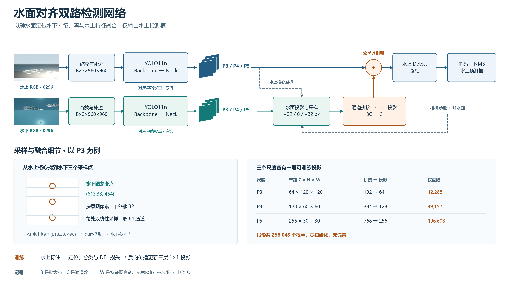

# 水面对齐双路检测器 · 模型与训练代码学习手册

这份手册以最终的 **水面对齐、水上输出**模型为主。图中的两路特征提取器来自已训练的水上、水下 YOLO11n。两台相机一起提供输入，损失与预测框都在水上视角计算。附图还提供[可缩放版](model_architecture_vivid.svg)。图中的输入缩略图取自仿真样本 0296。

## 1. 先把一次前向传播走通

**读图。** 一对样本有两张 $1280\times960$ RGB 原图。同一批样本读成两个张量。双路代码把每张图缩放到 $960\times720$，上下各补 120 像素，再按通道、行、列排列并除以 255。配对训练通常是 $B=12$，所以两个输入各是 $[12,3,960,960]$。水上和水下的图分别进入各自的网络。参见 [read_image](../../scripts/train_paired_fusion.py#L45) 和 [Pairs](../../scripts/train_paired_fusion.py#L56)。

**提取多尺度特征。** 张量按 $[B,C,H,W]$ 排列，$C$ 是每个位置的特征值个数，$H,W$ 是特征格的行列数。Backbone 连续降低分辨率并提取信息，Neck 再把深层信息和较细的网格结合起来。下表取自归档的 YOLO11n 层表和 960 输入规格。两个视角的结构相同，各自使用对应单路训练得到的权重。参见 [单路训练归档说明](../single_view_training_notes.md)。

| 位置 | 层或用途 | 每路输出（省略 $B$） |
|---|---|---:|
| 输入 | RGB | $3\times960\times960$ |
| Backbone 浅层 | 第 0 层 Conv | $16\times480\times480$ |
| Backbone 中层 | 第 2 层 C3k2 | $64\times240\times240$ |
| Backbone 送往 Neck 的三层 | 第 4、6、10 层 | $128\times120\times120$、$128\times60\times60$、$256\times30\times30$ |
| Neck 输出 P3 | 第 16 层，步幅 8 | $64\times120\times120$ |
| Neck 输出 P4 | 第 19 层，步幅 16 | $128\times60\times60$ |
| Neck 输出 P5 | 第 22 层，步幅 32 | $256\times30\times30$ |

**对齐与融合。** 对每个有效水上特征格，代码先把格子中心换回原图像素，再用相机内外参与静水面把该点投到水下图。以投影点为中心，在水下原图的竖直方向取 $-32,0,+32$ 像素的位置，双线性采样相应尺度的水下特征。三个位置的特征沿通道拼接，经过可训练的 $1\times1$ 卷积，最后加回该尺度的水上特征。三处采样的空间坐标由几何与固定偏移给出。参见 [水面投影和采样坐标](../../scripts/train_waterplane.py#L26) 。

| 尺度 | 三次采样拼接后 | $1\times1$ 权重形状（输出通道 × 输入通道 × 核高 × 核宽） | 加回水上后 | 更新参数数 |
|---|---|---|---|---:|
| P3 | $B\times192\times120\times120$ | $64\times192\times1\times1$ | $B\times64\times120\times120$ | 12,288 |
| P4 | $B\times384\times60\times60$ | $128\times384\times1\times1$ | $B\times128\times60\times60$ | 49,152 |
| P5 | $B\times768\times30\times30$ | $256\times768\times1\times1$ | $B\times256\times30\times30$ | 196,608 |
| 合计 | | | | **258,048** |

例如 P3 的某个水上格子有 64 个数。水下三个位置各提供 64 个数，拼成 192 个数。投影层的每个输出通道从这 192 个数计算一个加权和，共得到 64 个补充值。补充值加到原水上格子的 64 个数上。三个卷积都无 bias 且权重从零初始化，所以融合在训练的第一步开始前等价于水上单路。脚本在首批实际检查这项等价。参见 [AboveFusion](../../scripts/train_waterplane.py#L99) 与 [第一批等价性检查](../../scripts/train_waterplane.py#L222)。

**输出。** 三张融合特征图保持原先的通道和尺寸，因此可以接已有水上 Detect 头。$120^2+60^2+30^2=18,900$ 是每张图的候选位置数。归档层表记录 Detect 为 2 类、每条框边 16 个 DFL 档位，因此每个候选位置在解码前有 $4\times16=64$ 个位置分布值与 2 个分类得分值。推理时解码为四个框坐标与两个类别分数，随后执行 NMS 并将框还原到水上原图。双路脚本先用置信度 0.001 生成用于 AP 计算的候选，NMS 的 IoU 阈值为 0.70，最多保留 300 个框。固定计数使用置信度 0.25，预测与标注匹配使用 IoU 0.50。NMS 比较预测框之间的重叠，匹配 IoU 比较预测框和标注框的重叠。参见 [解码](../../scripts/train_paired_fusion.py#L200) 和 [匹配与评估](../../scripts/train_waterplane.py#L135)。

## 2. 每次训练究竟改了哪些东西

先区分 **超参数** 和 **模型权重**。批大小、学习率、最大轮数和采样偏移属于运行设置。卷积核系数属于可学习权重。单路训练微调检测网络，融合训练固定已有检测器，只更新新增的投影。

正式实验沿用 [划分 v1](../../splits/v1/README.md)，训练 1,400 对、验证 300 对、留出测试 300 对。单路各读取对应视角。随机种子为 42。下表的轮数是实际完成轮数，括号内注明配置上限和选中的最佳轮次。

| 实验 | 初始化与更新范围 | 批大小 / 输入 | 优化设置 | 实际轮数与选模 |
|---|---|---|---|---|
| 水下试训 | 两次均随机初始化，24 张小样本检查 | 8 / 960 | 第二次记录了 AdamW、lr=0.002、关闭预热、余弦衰减。第一次完整优化器日志未随本机结果归档 | 60、240 轮。在同一批训练图上诊断流程 |
| 水上单路 | 官方 YOLO11n，微调水上检测器 | 16 / 960 | 实际 AdamW，初始 lr=0.001667，$\beta_1=0.9$，预热配置 3 轮 | **29**（上限 40，最佳 **17**），耐心值 12 |
| 水下单路 | 独立载入同一个官方 YOLO11n，微调水下检测器 | 16 / 960 | 同水上单路 | **40**（上限 40，最佳 **39**，根据训练 CSV 的验证峰值） |
| 双路直接拼接 | 两路单路 best.pt 冻结。两个方向各三个投影，共 **172,032** 个可学习参数 | 12 对 / 每路 960 | AdamW 0.001，余弦衰减目标 0.0001，梯度裁剪 10 | **10**（上限 18，最佳 **5**），按两路验证 mAP50–95 的均值选模 |
| 水上输出，局部采样未对齐 | 同一对单路 best.pt，只训练三个水下补充投影，共 **258,048** 个参数 | 12 对 / 每路 960 | AdamW 0.001，余弦衰减目标 0.0001，梯度裁剪 10 | **7**（上限 12，最佳 **3**），按水上验证 mAP50–95 选模 |
| 水上输出，水面对齐 | 同未对齐一行。采样中心换成水面投影点 | 12 对 / 每路 960 | 同未对齐 | **12**（上限 12，最佳 **8**），按水上验证 mAP50–95 选模 |

**如何核对表里的数。** 单路的 args.yaml 写的是传入框架的配置，train.log 写的是实际决定的优化器。这里配置写了 optimizer=auto、lr0=0.01、momentum=0.937，日志解析为 AdamW、lr=0.001667、momentum=0.9。配置关闭 Mosaic、平移、随机缩放、水平翻转、HSV 变化和 AMP。单路正式网络层表共 2,590,230 个参数，其中 2,590,214 个标记有梯度。加载官方预训练时迁移了 448/499 项状态。参见 [水上运行配置](../../runs/above_single_v1/fit/args.yaml)、[实际优化器与层表摘录](../single_view_training_notes.md) 和 [水下逐轮记录](../../runs/underwater_single_v1/fit/results.csv)。

**三个融合实验怎么比较。** 原双输出直接拼接在同网格位置读取另一视角的 $C$ 个通道，每个方向新增 $\sum C^2=86,016$ 个参数。后两个水上输出实验都取三个位置、都用同一套有效区域规则，也都只算水上检测损失。两者只改变采样中心，分别为本格同坐标和水面投影点。用这一对对照能把几何对齐的影响看得更清楚。将正确搭档换成同成像条件下的另一样本，是用同一套训练完成的权重检验配对贡献。参见 [直接拼接配置](../../runs/paired_concat_v1/config.json)、[局部未对齐配置](../../runs/waterplane_above_v1/direct/config.json)、[水面对齐配置](../../runs/waterplane_above_v1/plane/config.json)。

原双输出拼接跑了留出测试。水面对齐这一轮记录的是参与选模的验证集，两套结果对应不同的评估样本。水面对齐在同一验证口径下的水上 mAP50–95 为 0.8094，未对齐局部拼接为 0.7967，水上单路为 0.7904，水面对齐模型用错配搭档时为 0.7917。固定阈值下，对齐相对单路找回 10 个、丢失 6 个。参见 [原双输出测试](../../runs/paired_concat_v1/README.md) 和 [水面对齐验证](../../runs/waterplane_above_v1/README.md)。

## 3. 关键代码怎么读

### A. 单路训练从哪里开始

[train_single_view.py 的 main](../../scripts/train_single_view.py#L135) 调用 prepare 整理图像与 YOLO 标签，随后交给 Ultralytics。关键调用为：

~~~python
model = YOLO(source)
fit = model.train(data=str(config), project=str(run), name="fit", epochs=args.epochs,
                  imgsz=960, batch=args.batch, device=args.device, workers=6, seed=42,
                  patience=12, amp=False, pretrained=args.weights is not None,
                  mosaic=0, translate=0, scale=0, fliplr=0, hsv_h=0, hsv_s=0, hsv_v=0, plots=False)
~~~

跟读时先找 source 如何指向官方权重，再找 train/val 清单如何变成每张图的标签，最后找 best.pt 和 results.csv 保存在哪里。两份单路 best.pt 是后续各自视角的初始化。

### B. 两路网络怎样冻结，三个特征怎样取出来

[Dual 的构造函数和特征读取](../../scripts/train_paired_fusion.py#L133) 载入两个单路模型，调用 eval 并关闭它们的参数梯度。features 用 no_grad 执行 Detect 以前的层。layers_before_head 依据每层的 f 读取上一层或缓存中的跳连输入，最后读取 Detect 配置里的 [16,19,22] 三个输出。

~~~python
self.detectors = nn.ModuleList(
    YOLO(str(path)).model.float().to(device).eval().requires_grad_(False)
    for path in checkpoints
)
~~~

水面对齐时仅调用水上头，训练时设置 head.training 取得损失函数所需的训练输出。已有检测头的参数仍冻结，检测损失的梯度可以经过检测头回到融合投影。

### C. 对齐主要看两个函数

[plane_camera](../../scripts/train_waterplane.py#L26) 用相机参数把平面世界点变成图像点。[calibration](../../scripts/train_waterplane.py#L39) 计算水上图到水下图的平面映射并用已知水面点核对投影。[sample_grids](../../scripts/train_waterplane.py#L77) 将每个尺度的格子中心变回原图坐标，做水面映射、加入三处偏移，再转换到 grid_sample 接受的归一化坐标。交点位于相机后方或采样落出图像的情况由有效区域过滤，越界特征由零填充处理。

把以上过程落到一个样例上，0296 的 P3 水上格心 $(613.33,496)$ 映射到水下 $(613.33,464)$，三个采样点的纵坐标为 432、464、496。这里的数字用于解释一个格子，实际推理会对所有有效格子应用同一规则。

### D. 哪一行把水下信息加进来

[AboveFusion.forward_head](../../scripts/train_waterplane.py#L114) 中，一个循环处理一个尺度。下面是其中的采样与融合原句：

~~~python
samples = [F.grid_sample(other, grid.expand(len(other), -1, -1, -1),
                         mode="bilinear", padding_mode="zeros", align_corners=False)
           for grid in self.grids[shape]]
output.append(own + layer(torch.cat(samples, dim=1)))
~~~

other 是水下特征，own 是水上特征，samples 有三份同形状张量。cat(dim=1) 拼接通道，layer 是该尺度的 $1\times1$ 卷积。可用 P3 检查加法成立的条件：192 通道经过投影回到 64 通道，高和宽都保持 120。

### E. 训练时究竟更新了什么

[水面对齐训练循环](../../scripts/train_waterplane.py#L214) 把 **model.fusion.parameters()** 交给优化器。box 衡量定位误差，cls 衡量类别预测误差，DFL 训练检测头表达框边界的离散分布。融合脚本使用 Ultralytics 的 v8DetectionLoss，并从框架配置读取损失权重。损失计算调用水上标签，反向传播后优化器只走新增投影的参数。关键原句：

~~~python
optimizer = torch.optim.AdamW(model.fusion.parameters(), lr=0.001)
~~~

~~~python
optimizer.zero_grad(set_to_none=True)
prediction = model.forward_head(maps, 0, "fusion", training=True)
loss = model.losses[0](prediction, batch_targets(rows, 0, device))[0].sum() / len(rows)
~~~

~~~python
loss.backward()
nn.utils.clip_grad_norm_(model.fusion.parameters(), 10)
optimizer.step()
~~~

每轮验证后，如果水上 mAP50–95 更高，就保存三个投影到 fusion.pt。这个文件需要配合原来的两个 best.pt 与相机映射使用。参见 [保存和重新载入最佳投影](../../scripts/train_waterplane.py#L241)。

建议按 **单路训练入口 → 取三个尺度 → sample_grids → forward_head → 训练循环** 的顺序读。读到每一步，在纸上写一次 P3 的输入输出：$64$ 通道水上特征、三份 $64$ 通道水下特征、$192\to64$ 投影、$64$ 通道送入检测头。最后回到运行表格，核对某次实验究竟改变的是图像输入、采样位置、评估方向，还是可更新权重。

